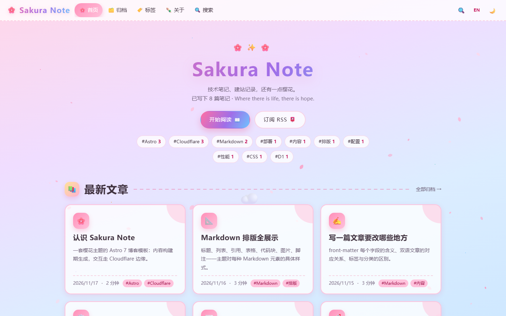
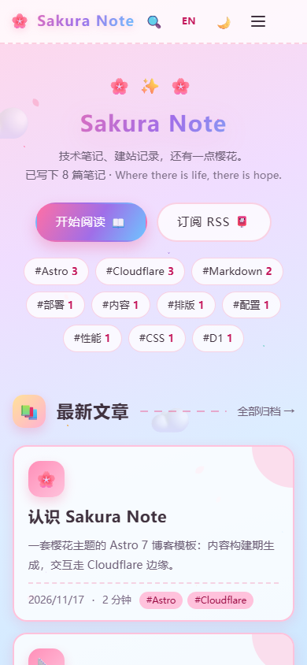

# Sakura Note

A bilingual (Chinese / English) Astro 7 blog theme with a soft sakura look and a Cloudflare-native runtime.

> Repository: <https://github.com/arleycn/sakura-note>




## Why this theme

- **Official Astro first**: content collections, `ClientRouter`, view transitions, `Actions`, `astro:env`, `@astrojs/sitemap`, `@astrojs/rss`.
- **Cloudflare from day one**: Workers Static Assets for prerendered pages, Worker routes for on-demand features, D1 for comments, KV for view counts, R2 for comment images, Images binding for runtime transforms, and Turnstile for spam protection.
- **Actually bilingual**: Chinese is the default locale without a prefix; English lives under `/en`. Both locales have their own posts, tags, RSS feed, SEO metadata, and hreflang links.
- **Responsive and calm**: three-column desktop grid, single-column mobile, dark mode, reduced-motion support, and a deliberately small animation budget.
- **Generic demo content**: 16 sample posts (8 topics × 2 languages) and placeholder links only. No personal articles, images, or accounts are bundled.

## Quick start

```bash
npm create astro@latest -- --template arleycn/sakura-note
cd sakura-note
npm install
npm run dev
```

Open <http://localhost:4321>. The English version starts at <http://localhost:4321/en>.

Requires Node.js `>=22.23.4`.

## What to edit first

| File | Purpose |
| --- | --- |
| `src/config.ts` | Site name, author, email, GitHub root URL, social links, sample sites, page size |
| `astro.config.mjs` | Deployment URL, i18n, integrations, environment schema |
| `src/lib/i18n.ts` | All UI strings in Chinese and English |
| `src/content/posts/zh/` | Chinese sample posts |
| `src/content/posts/en/` | English sample posts |
| `public/images/avatar.svg` | Placeholder avatar |
| `wrangler.jsonc` | Worker name, assets, D1 / KV / R2 / Images bindings |

All placeholder URLs use `example.com` or the root of a public service so anyone can fork the theme without inheriting personal data.

## Commands

```bash
npm run check       # astro check
npm run build       # production build
npm run preview     # local preview of the build
npm run dev         # local development
npm run og          # regenerate the default OG image
npm run smoke       # browser smoke test against a running Cloudflare dev server
npm run screenshots # capture README screenshots from a running server
```

Local Cloudflare runtime check:

```bash
npm run cf-typegen
npm run db:migrate:local
npm run build
npx wrangler dev --config dist/server/wrangler.json --persist-to .wrangler/state
node tools/smoke.mjs http://127.0.0.1:8787
```

## Deployment

The theme prerenders pages and serves them from Workers Static Assets. Only `/search`, `/media/*`, `/_actions/*`, and their `/en` variants run in the Worker, so normal page reads stay cheap.

1. Create Cloudflare resources:

   ```bash
   npx wrangler d1 create sakura-note-db
   npx wrangler kv namespace create VIEWS
   npx wrangler r2 bucket create sakura-note-media
   ```

2. Put the returned IDs into `wrangler.jsonc`, then run:

   ```bash
   npm run cf-typegen
   npx wrangler d1 migrations apply sakura-note-db --remote
   ```

3. Set build-time and runtime variables:

   ```bash
   PUBLIC_SITE_URL=https://your-domain.example
   PUBLIC_TURNSTILE_SITE_KEY=<optional>
   npx wrangler secret put TURNSTILE_SECRET_KEY
   ```

4. Deploy:

   ```bash
   npm run deploy
   ```

See [docs/DEPLOY_CLOUDFLARE.md](docs/DEPLOY_CLOUDFLARE.md) for the full checklist and rollback notes.

## Architecture

| Layer | Implementation |
| --- | --- |
| Content | `src/content.config.ts` + `glob()` loader + Zod schema |
| Navigation | `<ClientRouter />`, `astro:page-load`, `astro:after-swap` |
| Data RPC | Astro `defineAction` / `actions.*` / `isInputError()` |
| Styling | `src/styles/global.css`, CSS custom properties, no UI framework |
| Comments | D1 rows + KV rate limit + R2 image uploads + Turnstile |
| Views | KV counter with a six-hour cookie dedupe |
| SEO | canonical, OG, JSON-LD, sitemap hreflang, separate RSS feeds |

Handwritten parts that Astro does not provide: the sakura backdrop canvas, theme switch, comment storage/security logic, R2 proxy, and the local verification tools in `tools/`.

## Performance notes

The first version had ten permanent animations. An A/B measurement showed that `background-position` animation on large gradients and a full-screen twinkle layer were the main cost. They were removed; the remaining motion uses `transform`, runs at 30fps on canvas (24fps on low-end devices), and respects `prefers-reduced-motion`.

Measured in the same local harness before and after tuning:

| Metric | Before | After |
| --- | ---: | ---: |
| Main-thread task time | 362.8 ms | 120.4 ms |
| Style recalculation | 57.2 ms | 19.7 ms |
| Longest frame | 69.9 ms | 24.2 ms |
| Permanent animations | 10 | 3 |

Reproduce with `node tools/perf-ab.mjs` against a running dev server.

## Documentation

- [Getting started](docs/GETTING_STARTED.md)
- [Customization](docs/CUSTOMIZATION.md)
- [Cloudflare deployment](docs/DEPLOY_CLOUDFLARE.md)
- [Contributing](CONTRIBUTING.md)

## 中文简介

Sakura Note 是一个中英双语的 Astro 7 博客主题，使用官方内容集合、`ClientRouter`、Actions 和 `astro:env`；运行时基于 Cloudflare Workers Static Assets、D1、KV、R2 与 Images。中文为默认语言，英文在 `/en` 下。仓库内只放通用示例文章、占位头像和 `example.com` 链接，方便直接用于主题目录投稿。

常见问题与修改位置见 [docs/CUSTOMIZATION.md](docs/CUSTOMIZATION.md)，部署清单见 [docs/DEPLOY_CLOUDFLARE.md](docs/DEPLOY_CLOUDFLARE.md)。

## License

[MIT](LICENSE)
